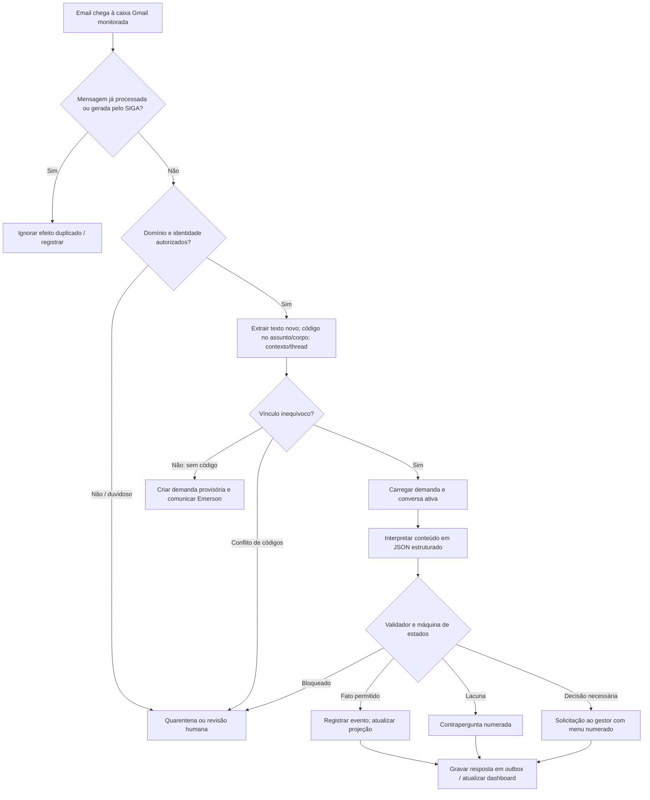
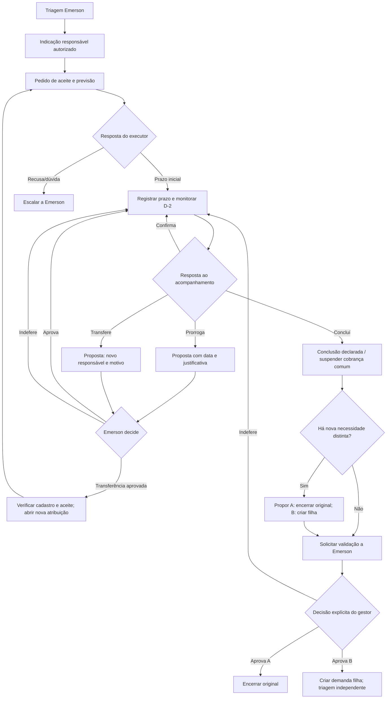

# 02 — Fluxos, estados, transições e guardas

## 1. Fluxo de entrada

## 2. Fluxo de execução e encerramento

## 3. Estados canônicos — demand.status

- `NOVA_TRIAGEM`: email novo sem código ou criação no painel; Emerson define tratamento.
- `AGUARDANDO_ATRIBUICAO`: foi triada mas ainda não existe responsável autenticado/aceito.
- `EM_EXECUCAO`: ao menos uma atribuição ativa de execução, ou com previsão inicial pendente mas já assumida.
- `AGUARDANDO_VALIDACAO`: executor declara conclusão de objeto/etapa sujeita à validação final (não equivale a encerramento).
- `ENCERRADA`: ato explícito de Emerson sobre demanda certa.
- `ARQUIVADA_SEM_DEMANDA`: classificada pelo gestor como mensagem meramente informativa/duplicada, com justificativa e auditoria (não é encerramento de atividade executada).
- `CANCELADA`: somente determinação expressa de competente e com razão; não usar como conclusão.

Solicitação não altera sozinha `demand.status`: demanda `EM_EXECUCAO` pode ter simultaneamente uma solicitação `PRORROGACAO` `AGUARDANDO_DECISAO`.

## 4. Estados de atribuições e solicitações

- `assignments.status`: `PROPOSTA`, `AGUARDANDO_ACEITE`, `ATIVA`, `CONCLUSA_DECLARADA`, `VALIDADA`, `TRANSFERIDA`, `RECUSADA`, `CANCELADA`.
- `requests.status`: `INCOMPLETA`, `AGUARDANDO_GESTOR`, `AGUARDANDO_CONDICOES`, `AGUARDANDO_ACEITE`, `APROVADA`, `INDEFERIDA`, `CANCELADA`, `OBSOLETA`.
- `emails.status`: `RECEBIDO`, `EM_ANALISE`, `PROCESSADO`, `REVISAO`, `IGNORADO`, `ERRO`.
- `outbox.status`: `PENDENTE`, `SIMULADO`, `ENVIADO`, `ERRO`, `CANCELADO`.

## 5. Matriz essencial de transições

| Situação | Gatilho | Guarda indispensável | Efeito |
|---|---|---|---|
| Nova sem código | Entrada autenticada e sem correlação | Inbox correta, não duplicada, novo corpo sem ID | Demanda provisória + triagem |
| Indicar Gabriela | Emerson atribui | Resolução de identidade ou espera | Atribuição pendente + e-mail de previsão |
| Gabriela diz `26/10` | Resposta ao pedido de previsão | Atribuição correta, ano/contexto claro | Prazo inicial 26/10, evento, D-2 consolidado |
| Gabriela diz `Mude para 30/10` | Solicitação de prorrogação | Justificativa ausente | `INCOMPLETA`, contrapergunta, prazo intacto |
| Emerson diz `Autorizo` | Resposta à aprovação vigente | Uma única solicitação aprovada inequívoca, identidade gestor, versão atual | Prazo 30/10, status da solicitação aprovada, reagendar D-2 |
| Gabriela diz `2 e 4` | Lembrete D-2 | Duas intenções; falta forma da transferência | Pedido de esclarecimento; sem mudanças |
| Gabriela concluiu vistoria, novo chamado | Resposta de esclarecimento | Conhecer objeto da etapa e natureza de nova necessidade | Conclusão parcial declarada + proposta filha |
| Gabriela diz `1 e 4` | Menu de confirmação específico | Menu ativo do e-mail relacionado | Registra documentos declarados e chamado ainda não aberto |
| Emerson diz `A1 e B1` | Menu duplo original/filha | Decisões individualizadas + permissões + versões válidas | Encerrar original; criar filha sem atribuir Manuel |
| Manuel não cadastrado | Aprovação de filha | Sem e-mail inequívoco | Triagem de identificação para Emerson; filha sem executor |
| Gestor é executor | Conclusão própria | Papel executor ≠ papel aprovador | Solicitar ato **separado explícito** de encerramento, com log próprio |
| Resposta citada contém `1` | E-mail com histórico citado | Conteúdo atual não contém autorização | Não aprovar |

## 6. Regras de precedência de interpretação

1. Contexto da mensagem/correlação + destinatário/proposta específica.
2. Texto **novo** escrito pelo remetente, não histórico nem rodapé.
3. Código válido novo no assunto/corpo; mensagens com códigos conflitantes vão à revisão.
4. Menus numéricos e sua versão identificada (ver `contracts/menus.json`): `1` só tem sentido diante do menu correspondente; `A1 B1` aplica-se a **duas** solicitações distintas.
5. Múltiplas intenções simultâneas não são tratadas como exclusivas; produzir uma lista de intenções e respectivas lacunas.
6. Resposta `Autorizo` sem ressalvas só quando uma solicitação pendente está clara; condicional `autorizo, se...` gera decisão com ressalvas.
7. Preferir esclarecimento específico ou revisão quando ações incompatíveis são propostas.

## 7. Datas, eventos e condições de disparo

- Data empresarial é um `YYYY-MM-DD` local; timestamps armazenados como ISO UTC.
- Calendário de dias não úteis configurável. Proposta: fim de semana inicialmente, sem supor feriados não cadastrados.
- Exemplo: data de entrega 26/10/2026 (segunda), D-2 = 24/10/2026 (sábado), antecipa para 23/10. Se prazo confirmado em 23/10, enviar uma única mensagem e registrar aviso como atendido.
- Exemplo: prazo prorrogado e aprovado para 30/10/2026 (sexta), D-2 = 28/10/2026 (quarta). Reagendar evento novo e invalidar agenda antiga, mantendo evidência histórica.
- Tarefas em `AGUARDANDO_VALIDACAO` não recebem cobranças de execução; executar rotina separada de alerta ao gestor.
- Disparadores e alertas usam chave idempotente composta: `atribuição + versão_de_prazo + tipo_de_lembrete + janela`.

## 8. Regras do ciclo de esclarecimentos

Perguntar sempre de maneira concisa e com menu numerado, quando útil. Escalonar para Emerson após limite configurável de duas interações infrutíferas por pendência; nem o tempo de espera nem uma resposta irrelevante permitem inventar decisão. Não sobrescrever proposta anterior até conclusão; manter correlação com `request_id` e `menu_version`.
