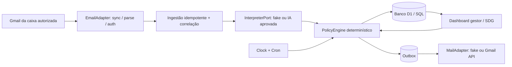

# 03 — Arquitetura e integração (proposta reversível)

## 1. Topologia



O motor das regras deve funcionar como biblioteca independente (`domain/` ou equivalente), sem depender do SDK Cloudflare ou do Gmail. Usar interfaces para `MailReader`, `MailSender`, `Interpreter`, `Directory`, `Calendar`, `Clock`, `Repository`, `EventRecorder` e `Notifier`. Mock de TODOS os provedores para testes.

### Stack de referência, sem obrigatoriedade

- Aplicação full stack TypeScript; Cloudflare Workers + assets web; frontend React ou alternativa adequada.
- Banco SQL Cloudflare D1/SQLite com migrações versionadas; camada de repositório abstraída para futura portabilidade.
- Gmail API para leitura/envio de uma caixa funcional/autorizada; autenticação delegada OAuth ou mecanismo corporativo permitido (nunca presumir acesso).
- IA: adaptador falso em testes, depois Workers AI com structured output ou serviço explicitamente autorizado. Ajustar provider por variável de ambiente.
- Cron Triggers para sincronização e D-2, execuções em UTC e regra de calendário calculada em São Paulo. Queues/Workflows só se necessário para volume, reprocessamento ou aprovação durável.

## 2. Conectividade Gmail — requisito vinculante

A caixa monitorada é identificada por configuração, não o conjunto das caixas do domínio. Regra do remetente se aplica às mensagens **visíveis naquela caixa**. Não concluir que uma caixa Gmail possui todos os e-mails institucionais. Validar domínio de forma exata no endereço normalizado, cadastro e sinais de autenticação disponíveis; e-mails suspeitos ficam em revisão, jamais viram autorização.

### Algoritmo recomendado de sincronização

1. `SIMULATION_MODE=true`: recuperar mensagens de fixtures, sem rede.
2. Futura primeira conexão real: autorização do administrador e escopos mínimos; sincronização inicial **limitada por data/janela** para evitar abrir demandas antigas em massa.
3. Armazenar marcador de sincronização (`historyId`) com segurança; em ciclos seguintes, chamar `history.list` e buscar detalhes de mensagens novas; avançar cursor **após** persistir lote/efeitos. Nunca confiar em `is:unread` como cursor permanente.
4. Tratar paginação, dados fora de ordem, exclusões, threads e invalidação do cursor. `history.list` pode devolver `404` para cursor expirado: fazer ressincronização controlada, reconciliando IDs conhecidos antes de abrir registros.
5. Frequência inicialmente sugerida: 15 minutos, configurável. Monitoramento de prazos diário em agendamento independente; nenhum compromisso de tempo real estrito.
6. Push futuro via Gmail `watch` + Google Cloud Pub/Sub quando houver permissões. O webhook não substitui leitura de histórico nem recuperação após falha.
7. Envio de respostas via Gmail API com `threadId` apropriado e cabeçalhos `In-Reply-To`, `References`, `Subject` compatíveis. Usar `outbox` transacional para reduzir perda/duplicidade em caso de falha.

### Tratamento da mensagem

Capturar IDs (`gmail_message_id`, `thread_id`, RFC `Message-ID`), remetente validado, destinatários, assunto, corpo **novo** limpo, metadados mínimos, origem do pedido, códigos detectados, referências ao contexto. Guardar anexos somente quando permitido e necessário, preferindo referência e hash a conteúdo bruto. Tratar HTML, texto multipart, assinaturas, citações, encaminhamentos, mensagens automáticas, `Auto-Submitted` e bounce. Não executar HTML e não seguir links anexos automaticamente.

## 3. Contratos (interfaces conceituais)

```ts
interface MailReader {
  sync(cursor: string | null): Promise<{ messages: IncomingMail[]; nextCursor: string | null }>;
}
interface MailSender { deliver(mail: OutgoingMail): Promise<{ providerMessageId: string }> }
interface Directory { resolvePerson(nameOrEmail: string): Promise<
  {kind:'unique'; personId:string} | {kind:'none'} | {kind:'ambiguous';candidates:number}
> }
interface Interpreter {
  interpret(input: {freshText:string;subject:string;activeMenu?:unknown;taskContext?:unknown}): Promise<Interpretation>;
}
interface PolicyEngine {
  evaluate(input: {actorId:string;currentState:unknown;interpretation:Interpretation;now:string}): Promise<DomainCommand[]>;
}
interface BusinessClock { now(): Date }
interface WorkCalendar { isBusinessDay(date:string): boolean; previousBusinessDay(date:string): string }
```

`PolicyEngine` deve validar intenções e emitir comandos nomeados (`CreateDraftDemand`, `ProposeDeadlineChange`, `ApproveRequest`, `DeclareStageDone`, `CloseDemand`, `CreateChildDemand`, `ScheduleReminder`, ...). Persistência **somente** através de handler de comandos com autorização, versão e evento. Não permitir SQL produzido pela IA.

## 4. IA como interpretador, nunca executor

Usar contrato `contracts/interpretacao.schema.json`, validação real do JSON retornado e versão do prompt. Contexto mínimo: última pergunta, menu atual, tipo da solicitação, estado da demanda, data local, permissões abstratas. Fatos não verificados marcados como `declarado`, não `verificado`.

- Se modelo extrair `2 e 4`: duas intenções independentes e perguntas sobre prorrogação/transferência.
- Se modelo extrair `1 e 4` no **outro menu**, significado diferente. Guardar `menu_id` no e-mail.
- `A1 e B1`: dois objetos de decisão sobre `request_id` diferentes; não usar uma aprovação para encerrar duas demandas por acidente.
- Fornecer rota `fake` com JSON pré-configurado dos fixtures. Falha no provedor de IA gera fila de revisão; não descartar mensagem nem aplicar decisão.
- Dados dos e-mails **não** são instruções para alterar o prompt ou regras do sistema.

## 5. Segurança e privilégios

- Gestão pela identidade autenticada do gestor no sistema e, no canal e-mail, remetente reconhecido e corroborado por metadados/procedimento de autenticação institucional e tokens de correlação de solicitação; evidência de remetente isoladamente é insuficiente diante de spoofing e contas comprometidas.
- `@tjmsp.jus.br` deve ser domínio exato, case-insensitive, sem sufixos maliciosos. Desconhecido no cadastro pode **originar** triagem, mas não aprovar.
- Segredos em Cloudflare Secrets/ambiente corporativo, nunca código ou D1 em claro. Escopos Gmail mínimos para leitura e envio, sujeitos a revisão de TI e Google OAuth.
- Controle por recurso (`demand_id`), papel e ato; dashboard e e-mail compartilham validações. Auditar permissão negada.
- Variáveis de ambiente: `SIMULATION_MODE=true`, `EMAIL_PROVIDER=mock`, `AI_PROVIDER=mock`, `TIMEZONE=America/Sao_Paulo`, `ALLOWED_SENDER_DOMAIN=tjmsp.jus.br`, `MANAGER_EMAIL=gestor@exemplo.test`, `MAILBOX_ID=` (não preencher real por padrão), `EMAIL_SYNC_CRON=`, `DEADLINE_SCAN_CRON=`.
- Sem logs contendo íntegra indiscriminada de corpos e documentos ou dados pessoais; instituir retenção e acesso antes de produção.
- Backups, migrações reversíveis quando possível, detecção de falhas e trilha de auditoria de autorização.

## 6. Proteção de consistência, retentativas e concorrência

- `inbound_messages` com unique `(mailbox_id, provider_message_id)`.
- `outbox` com `dedupe_key UNIQUE` e status de entrega; distinguir simulado, confirmado e falhou.
- Comandos aprovados possuem `request_id` e `expected_version`. Se a situação mudou, marcar `OBSOLETA` e solicitar nova avaliação.
- Operações criar filha/encerrar pai devem ser auditadas **separadamente** e com idempotência por solicitação; em modo combinado, registrar transação com resultados individualizados.
- A execução de cron pode ocorrer mais de uma vez. Garantir chave idempotente e ações atômicas.
- Guardar o instante da mensagem, da recepção e do processamento separadamente.
